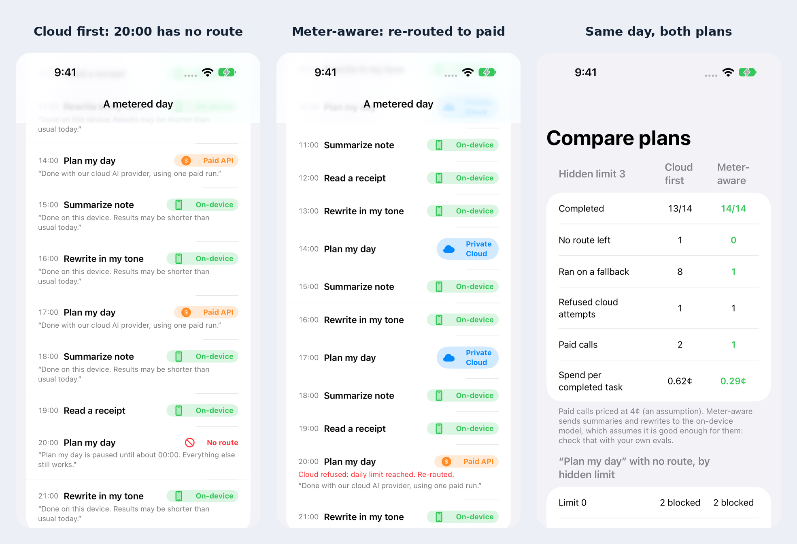

# MeteredInference

**Route each AI feature across on-device, Private Cloud and a paid API when the platform meters the cloud and won't tell you the limit.**

Starting with iOS 27.3 (in beta as of November 2026), Apple puts a daily, per-device limit on "Third-party apps using Apple Foundation Models in Private Cloud Compute" ([Apple Support](https://support.apple.com/en-us/127901)). Apple documents no way for an app to read that limit. The system notifies the user; as far as is documented, the app only sees a refused request. This package is a small, tested model of how an iOS app can plan for that:

- **`InferenceRouter`** walks a feature's tiers in preference order and returns the first one that can take the request, with a reason for every tier it skipped. `plan` is pure.
- **`PlatformLimitTracker`** remembers a cloud refusal until the estimated reset (next local midnight), so the app stops sending requests it knows will bounce. After the estimate passes, the next request tries the cloud again and a success clears it. It's `Codable`, so you can persist it across launches.
- **`UsageLedger`** meters your own paid tier the way Apple describes its intelligence usage packs (a monthly allowance that doesn't roll over; packs that roll over, expire 12 months after purchase and are spent only after the allowance), plus two choices of mine: earliest-expiring pack first and all-or-nothing debits.
- **`MeteredSession`** runs requests (sync or `async`), re-plans in the same request after a refusal, and records every attempt.
- **`SessionReport`** gives the numbers to watch: completed, degraded, no route, refused attempts, paid calls and spend per completed task.
- **`QuotaCopy`** turns a result into a message that tells the user the truth, including roughly when a paused feature comes back.

Article: (added after publish)



## The modelled day

`SampleDay` has four features, each with tiers in preference order:

| Feature | Meter-aware order | Cloud-first order |
|---|---|---|
| Summarize note | On-device, Private Cloud | Private Cloud, On-device |
| Rewrite in my tone | On-device, Private Cloud | Private Cloud, On-device |
| Plan my day | Private Cloud, Paid API | Private Cloud, Paid API |
| Read a receipt | On-device | On-device |

One user sends 14 requests, one an hour from 08:00 to 21:00 UTC. The platform accepts a hidden number of cloud requests (3 by default) and then refuses. The paid tier has 1 included run this month plus a 1-run pack. Paid calls are priced at 4¢. **All of these numbers are assumptions chosen to be easy to follow, not measurements.** Apple doesn't publish the limit.

| Hidden limit 3 | Cloud first | Meter-aware |
|---|---|---|
| Completed | 13/14 | 14/14 |
| No route left | 1 | 0 |
| Ran on a fallback | 8 | 1 |
| Refused cloud attempts | 1 | 1 |
| Paid calls | 2 | 1 |
| Spend per completed task | 0.62¢ | 0.29¢ |

`SampleDayTests` pins these numbers, and checks every hidden limit from 0 to 16: meter-aware never leaves "Plan my day" without a route more often and never makes more paid calls than cloud first.

The meter-aware result depends on one assumption the router can't check: that the on-device model is good enough for summaries and rewrites. Prove that with your own evals before you reorder anything.

## The router

```swift
public func plan(_ feature: FeatureProfile, at date: Date, onDeviceModelAvailable: Bool) -> RouteDecision {
    var skipped: [Skip] = []
    for tier in feature.tiers {
        if let reason = blocker(for: tier, feature: feature, at: date, onDeviceModelAvailable: onDeviceModelAvailable) {
            skipped.append(Skip(tier, reason))
        } else {
            return .run(tier, skipped: skipped)
        }
    }
    return .unavailable(skipped: skipped, retryAround: skipped.compactMap(\.reason.resetsAround).min())
}
```

```swift
var session = MeteredSession(router: router, paidCallCostCents: 4)
let result = await session.perform(SampleDay.planDay, at: now) { tier in
    await callModel(on: tier)   // your code: returns .succeeded, .platformLimitReached or .failed
}
let message = QuotaCopy.message(for: result, feature: SampleDay.planDay, now: now, timeZone: .current)
```

## How to run it

1. `git clone https://github.com/rajatslakhina/apple-ai-meter-article-demo.git`
2. Open `Demo.xcodeproj` in Xcode.
3. Pick an iPhone Simulator and press Build & Run. There's no other setup. The project uses this repo's package through a local package reference.

The app has three tabs: **Day** (the 14 requests under either plan), **Compare** (both plans side by side, plus "Plan my day" blocked counts for hidden limits 0 to 6) and **Ledger** (a 5-unit debit across an allowance and three packs, one of them expired).

Library only: `swift build` and `swift test`. The shared Demo scheme builds and runs the app only; run the tests with `swift test` or the package's own scheme in Xcode.

Requirements: iOS 17+ / macOS 14+, Swift 5.9 tools. Built and tested locally with Xcode 27.2 (Swift 6.4.2).

## Honest limits

- **No real model calls.** The demo simulates the platform's refusal. I don't claim to know the exact error type or API shape Apple's framework uses for it; wire `AttemptOutcome.platformLimitReached` to whatever your real call returns.
- **The reset time is an estimate, with no early retry.** Apple says limits reset "around midnight" in the user's time zone, with exceptions for international travel, Family Sharing (the plan purchaser's time zone) and signed-out devices (about 24 hours after first use). The tracker uses the next local midnight. If the real reset comes earlier, the cloud stays off until local midnight anyway.
- **The limit is modelled as a request count.** Apple says it varies with request complexity and system demand, which is why the tests sweep the count from 0 to 16 rather than trusting one value.
- **The tracker uses the time zone it was created with.** Rebuild it when the device time zone changes. If the real reset comes later than local midnight (travel, a Family Sharing purchaser further west), a request in the gap is refused; a refusal after an expired estimate, before any cloud success, backs off for an hour (capped at the next local midnight) instead of a whole day. A limit genuinely spent before your first request of the day (for example by the user's other apps) looks the same, so it costs at most one refused request an hour.
- **The demo's paid copy is generic.** "Done with our cloud AI provider" should name the real vendor in a shipping app.
- **State is in memory.** Nothing is persisted. Persist `PlatformLimitTracker` (it's `Codable`) or every relaunch spends one more refused request.
- **Not concurrency-safe by itself.** The router, ledger and session are value types. The async `perform` is `mutating`, so call it on a session your code owns locally and run requests one at a time. Swift won't let you call it on an actor's or `@MainActor` model's stored property across an `await`. For parallel requests, wrap the session in your own actor and serialise requests through it.
- **The paid ledger lives on the client here.** In a real app, the server must own the ledger and the debit, or a modified client can spend units it doesn't have.
- **Falling back from Private Cloud Compute to your own API is a privacy change.** It leaves PCC's privacy guarantees behind and sends the request (for "Plan my day", calendar and personal context) to your server and a model vendor. Disclose it, get the user's permission before sending personal data to a third-party model, and update your privacy label. For some features the right fallback is "paused", not "paid".
- **Only a refusal moves down the ladder.** A `.failed` attempt ends the request as failed; the caller decides whether to retry.
- **The ledger follows Apple's published pack rules as a model.** It is not Apple's implementation.
- **"Degraded" means a preferred tier was skipped or refused.** It doesn't measure output quality.

## Verification status

- `swift build -Xswiftc -warnings-as-errors` (clean build after `rm -rf .build`): passes on macOS with Xcode.
- `swift test`: **29 tests, 0 failures**.
- iOS Simulator: built with `xcodebuild` and run headless on a dedicated new iPhone 18 Pro simulator (iOS 27.2). `Scripts/simulator-screenshots.sh` launched the app six times by launch argument, checked the process was still alive after each launch, and saved the screenshots in `Demo/Screenshots/`.
- CI: `.github/workflows/ci.yml` runs the build, tests and Simulator script on pushes to `main` and on pull requests (code changes only). Result for this version: (filled in after the first run)

## Sources

- Apple Support, [Learn about iCloud+ with Apple Intelligence and Siri AI](https://support.apple.com/en-us/127901) (published 16 Nov 2026): the metered feature categories, per-device daily limits, reset rules, iCloud+ multipliers and regional exclusions.
- Juli Clover, MacRumors, [iOS 27.3 Beta Adds Daily Siri AI Limits and iCloud+ Upgrades](https://www.macrumors.com/2026/11/16/apple-icloud-paid-siri-ai-upgrade/) (16 Nov 2026).
- Apple Support, [About the intelligence features in Apple Creator Studio](https://support.apple.com/en-us/127888): the intelligence usage pack terms (roll over month to month, expire 12 months after purchase, used only after the monthly limit).
- Ryan Christoffel, 9to5Mac, [Apple launches $50 'intelligence usage packs' for select AI features](https://9to5mac.com/2026/11/09/apple-launches-50-intelligence-usage-packs-for-select-ai-features/) (9 Nov 2026), which quotes Apple's pack terms.

## License

MIT. See [LICENSE](LICENSE).
